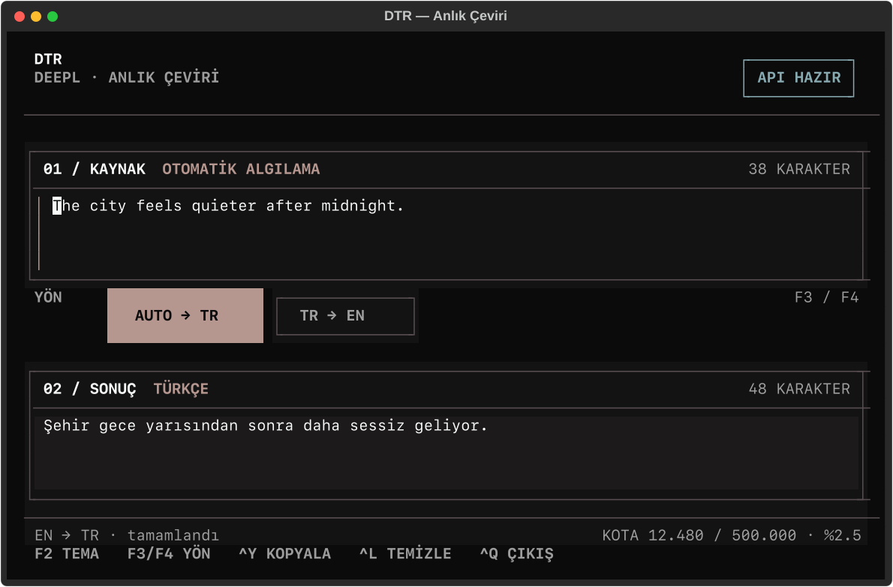

# DTR — Anlık Çeviri

DeepL destekli, klavye odaklı terminal çeviri arayüzü. Metin yazılırken otomatik çevirir; hem yabancı dillerden Türkçeye hem Türkçeden İngilizceye çalışır.



## Tasarım

DTR varsayılan terminal bileşenlerini ürün yüzü gibi kullanmaz. Etkin Omarchy temasının renklerini başlangıçta okuyarak mevcut sistem görünümüyle hizalanır; Omarchy yoksa yerleşik Lasthorizon paletine döner. Grafit yüzeyler, soluk gül vurgusu, sakin API/kota durumu ve yönü görünür kılan merkez omurga ile yoğunluğu düşük bir çalışma alanı sunar. Koyu ve açık tema tercihleri kalıcıdır.

## Kullanım

| Kısayol | İşlev |
| --- | --- |
| `F3` | Otomatik algıla → Türkçe |
| `F4` veya `Ctrl+E` | Türkçe → İngilizce |
| `Ctrl+J` | Hemen çevir |
| `Ctrl+G` | Panodan yapıştır |
| `Ctrl+Y` | Sonucu kopyala |
| `Ctrl+L` | Alanları temizle |
| `F2` | Koyu/açık tema |
| `Ctrl+Q` | Çıkış |

Yön düğmeleri fareyle de kullanılabilir. Yazma durduktan kısa süre sonra çeviri otomatik başlar.

## Kurulum

```bash
git clone https://github.com/talhacaglar/TUI-Anlik-Cevirmen.git
cd ceviri-tui
./run.sh
```

İlk çalıştırmada `.venv` oluşturulur ve proje yerel olarak kurulur. DeepL API anahtarı yoksa DTR sade bir kurulum ekranı açar ve anahtarı yalnızca repodaki, Git tarafından dışlanan `.env` dosyasına kaydeder.

Anahtarı önceden eklemek için:

```bash
cp .env.example .env
# .env içindeki DEEPL_AUTH_KEY değerini düzenle
```

Pano entegrasyonu Wayland'da `wl-clipboard`, X11'de `xclip` veya `xsel` gerektirir.

## Geliştirme

```bash
.venv/bin/python -m unittest discover -s tests -v
env -u NO_COLOR TERM=xterm-256color COLORTERM=truecolor \
  .venv/bin/python scripts/make_screenshots.py
```

## Lisans

MIT
